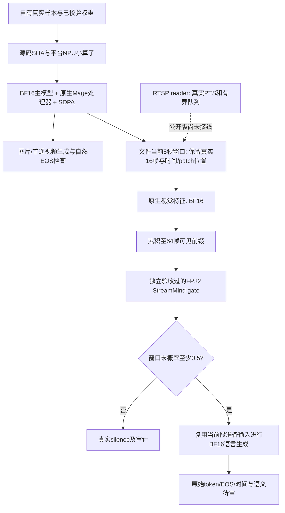

# 路径与边界

源文件顺序解码到当前窗口后作门控；没有提前解码未来窗口。gate仍重算可见前缀，不是增量Mamba状态。当前段请求内输入/视觉特征复用不是量化权重展开缓存。普通video资格路径保留两次预处理用于审计，stream_fast路径消除重复媒体准备。

参数化配置只改变输出根和模型路径；数学函数/class AST与历史文件一致，见 evidence/source-reuse-validation.json。CLI、特征导出和资格包装是公开版新增集成层，需另外做目标NPU端到端验收。NPU模型、API守护进程、远程连接、业务工作台是不同组件，本仓库只交付表明范围内的CLI与源码组件。
